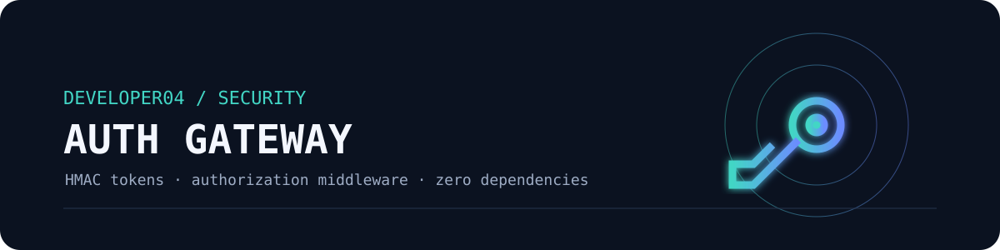

<p align="center"></p>

# D04 Auth Gateway

A dependency-free authentication toolkit for Node.js APIs. It provides HMAC-SHA256 tokens, strict verification, Bearer extraction, and Express-compatible authorization middleware.

## Features
- HMAC-SHA256 signing with constant-time signature comparison
- Expiration, issuer, and audience validation
- Configurable Express-compatible middleware
- Secure opaque token generation using Node.js crypto
- No runtime dependencies; Node.js 20+

## Install
```bash
npm install
```

## Sign and verify
```js
import { signToken, verifyToken } from "d04-auth-gateway";
const secret = process.env.AUTH_SECRET; // random value, at least 32 bytes
const token = signToken({ sub: "user_42", role: "admin", iss: "accounts", aud: "api" }, secret, { expiresIn: 900 });
const claims = verifyToken(token, secret, { issuer: "accounts", audience: "api" });
console.log(claims.sub);
```

## Express integration
```js
import express from "express";
import { createAuthGuard } from "d04-auth-gateway";
const app = express();
app.get("/private", createAuthGuard({ secret: process.env.AUTH_SECRET }), (req, res) => {
  res.json({ subject: req.auth.sub, role: req.auth.role });
});
```

The guard returns HTTP 401 for missing or invalid credentials and attaches verified claims to `req.auth`.

## API
| Export | Purpose |
| --- | --- |
| `signToken(payload, secret, options)` | Sign a token with expiration |
| `verifyToken(token, secret, options)` | Verify signature and claims |
| `bearerToken(header)` | Extract a Bearer token |
| `createAuthGuard(options)` | Create authorization middleware |
| `createOpaqueToken(bytes)` | Generate a secure random token |

## Security
Keep secrets in environment variables or a secret manager. Use HTTPS, short token lifetimes, key rotation, and server-side authorization checks. This package is a signing primitive, not a full OAuth/OIDC provider.

## Tests
```bash
npm test
```

## License
MIT
